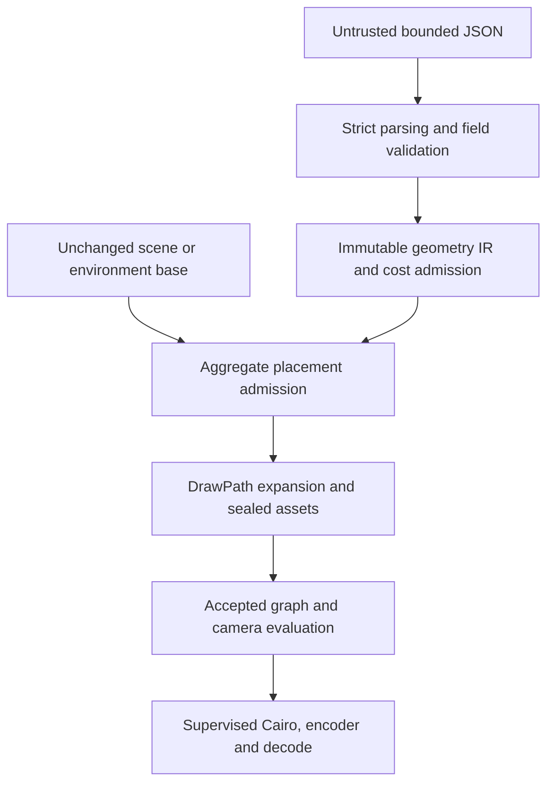

# Phase 5C — novel declarative vector geometry review candidate

Approved base: `82ebbe08e57f7f13217e64c57b86df994da1541b`.
Branch: `phase5c-novel-vector-geometry`. Local engineering/export only; no GitHub push,
deployment, new audio system or Phase 6A.

## Outcome

geometry-0.1 and the additive composition-0.1 allow an author to describe previously unknown
compound vector objects with strict JSON and place their instances into accepted layouts and
all three procedural environment families. No named-object artwork recipe was added. The
four original demonstrations and held-out wash station are public JSON documents; the engine
has no dispatch for their IDs. Existing contracts and production CLI behavior remain unchanged.

This is a review candidate, not an independent acceptance claim. Development-host temporary
path restoration is reported separately from geometry, media and timing results. Independent
Ubuntu 24.04 / Python 3.12 validation remains mandatory.

## Trust boundary and architecture

`geometry.contract` contains finite-value, path/material, transform/bounds and expansion
validation. It creates frozen ShapeIR/AssetIR/Document values. Ordered groups flatten into
bounded leaf IR with composed similarity transforms; one shape expands to one accepted
DrawPath. Four fixed cubic segments implement ellipses; polygons expand to M/L/Z. Clips count
against each asset and scene budget. `geometry.compiler` checks actual expansion counts and
seals the geometry in the accepted private namespace. There are no dynamic imports, external
resources, executable expressions, arbitrary SVG or general rendering plugins.

`geometry.composition` validates a complete unchanged base manifest and local placement data.
The base's conservative envelopes plus the exact authored counts of **every** placement are
checked before procedural or authored drawing expansion. The accepted graph then validates
hierarchy, composed transforms, inherited visibility, painter order and parallax. One authored
asset can be instanced repeatedly without duplicating its static catalog entry; every visual
instance still pays its full geometry cost. Authored assets have no support envelope and
cannot become character ground.

`tools/geometry.py` exposes native-free schema/validation/inspection, static asset preview and
scene render. The strict job monitor surrounds compilation and native processing. The accepted
scene renderer still reserves fresh directories, uses one frame surface and streams a bounded
FFmpeg job. A cleanup failure returns a failing command even when valid media is preserved.
No accepted source file in renderer, media, audio, resources, scenes or procedural recipes was
modified. The complete trust language and exact limits are in [NOVEL_GEOMETRY.md](NOVEL_GEOMETRY.md).

## Data-authored demonstrations

- **Damaged mast:** tapered truss, cross-bracing, guy anchors, damaged dish, cabinet, indicator,
  vent divisions and cubic cabling; metal/rust distinctions and a ground shadow.
- **Water cart:** two wheels with hubs/spokes, frame, handle, strapped tank, top/side faces,
  lid and valve. Its silhouette is independent of any generator recipe.
- **Watchtower:** compound shelter/platform, supports, bracing, ladder and railings; a local
  group keeps roof/wall/window relationships explicit.
- **Field radio:** front/side/top case faces, handle, tuning control, translucent clipped display
  highlight, aerial, vents, battery and coiled cable.
- **Held-out wash station:** a fresh textual brief specifies an overhead steel arch, shower
  head, side tank, hand pump, hose, valve and grated tray. Only JSON was added after the captured
  compiler/tool snapshot. The source hashes remain unchanged. This is an authoring exercise,
  not a statistically blinded test or engine natural-language understanding.

The public composition examples cover woodland relay, settlement checkpoint, shelter supplies,
orchard checkpoint and a woodland wash station. Mast/cart/radio reuse is visible in the contact
sheets and exact placement JSON. The watchtower is positioned at the settlement's right edge;
it deliberately sits among existing structures. No character-object interaction is implied.

## Artistic review

The showcase and scene pixels were inspected, including full-resolution originals and sampled
start/middle/end film frames. The objects are structurally recognizable and more detailed than
single colored polygons. The shared muted steel/olive/wood palette, dark cavities, face shading,
edge highlights and restrained amber accents fit the accepted environment style. The cart's
wheels meet its frame, the tower's braces/ladder connect to the platform, cabling connects to
fixtures, and the held-out station has a readable person-sized opening.

The mast's thin bracing and the radio's controls are clearest in the full-resolution showcases;
some detail becomes small in wide compositions. Foreground foliage deliberately occludes part
of the woodland mast, and the settlement tower sits close to the right crop. These are reviewed
placements rather than guaranteed automatic composition. Explicit coordinates still require
manual art direction. The cart's tank is broad relative to Rowan, but remains a plausible
supply load; its shadow/contact is illustrative rather than physically solved.

Material shading is authored, static and approximate. New assets do not automatically receive
scene-aware cast shadows, occlusion or physically based lighting. Internal groups share their
instance's parallax; there is no perspective reconstruction, moving mechanism, water simulation,
wind or character interaction. Background atmosphere, existing procedural repetition and rigid
Rowan acting retain the accepted engine's limitations. No Stickocalypse quality parity or
unlimited object-generation quality is claimed.

## Security and resource evidence

Targeted tests exercise hostile keys/code strings, forbidden asset namespaces, wrong types,
boolean numbers, nonfinite and enormous coordinates, malformed/degenerate contours, gradients,
clipping, unsupported transforms, nested groups, expansion limits before DrawPath allocation,
unknown references, shared instances, support restrictions, deterministic evaluation, native
failure/cancellation cleanup and protected outputs. Rejected inputs never invoke the renderer
or create their requested artifact directory. Only the explicitly supplied top-level input
file is read; nested JSON cannot select files.

The exact caps are unchanged: CPU-only 720 × 1280/30 FPS, strict 256 MiB process tree with
64 MiB reserve; 64 nodes, 32 instances, 8 layers, 4096 DrawPaths and 80000 path/clip operations.
geometry-0.1 adds tighter document/per-asset caps rather than increasing accepted scene limits.
No recursion through asset references, unbounded duplication, accumulating frame state or
unlimited cache was introduced. Source geometry and pixels are evaluated out of order and
repeated. All frame processing uses the accepted absolute frame index.

Sampled summed RSS can miss transient peaks and double-count shared pages. Shared cgroup
observations are not dedicated job attribution. This host is development evidence, not target
VM certification. Proof rendering is sequential, and whole-job monitoring also covers the
parent review process and its child renderers/encoders. Contact sheet assembly is separate
bounded review work. Native-backend/codec pixel identity is claimed only on the pinned build.

## Review evidence map

- `examples/geometry/`: four compound objects, held-out description/object and intentional
  invalid inputs with expected errors; no private Python recipes.
- `examples/compositions/`: complete embedded public geometry/base/placement documents.
- `artifacts/phase5c/*schema.json`, `capabilities.json`, `*_inspection.json`: discoverable
  contract, compiled counts, anchors, IDs, graph/depth/contact inspection and geometry hashes.
- `proofs/asset_*`: full-resolution static showcases and layer PNGs.
- `proofs/*_stills`: five layouts, start/middle/end and transparent layer breakdowns.
- `proofs/*_video`, `proofs/settlement_repeat`: two original 90-frame films and one controlled
  repeat with source/decoded hashes, CPU/raster/stream timings and resources.
- `asset_showcases.png`, `scene_compositions.png`, `camera_contact_sheet.png`,
  `reuse_comparison.png`: visual assessment and object reuse at different positions/scales.
- `determinism.json`, `video_repeat.json`, `compiler_before_heldout.json`, `heldout_evidence.json`:
  out-of-order equality, complete film repeats and held-out compiler invariance.
- `proof_execution.json`: every CLI return code, including cleanup failures; no discarded retry.
- Final test, build, wheel smoke, compatibility and decode records are included with the handoff.

## Follow-up boundary

Independent engineering/security/artistic review and clean-host validation must precede
acceptance. Improved authoring assistance, perspective-aware layout, independently animated
subparts, terrain support or general script interpretation require later reviewed contracts;
none are supplied here. No next phase, deployment or publishing operation is authorized.

## Final verification results

Pinned development environment: CPython 3.12.14, Pycairo 1.29.2, Cairo 1.18.0; exact system
FFmpeg version/build is in `versions.json`. `uv sync --frozen --extra renderer` passed.

The complete 795-case native suite reports **794 passed, 1 failed, zero fixture errors**.
All **103 new geometry tests pass**; all 692 accepted baseline cases remain unchanged.
The sole failed baseline case is
`tests/test_video_integration.py::test_engineering_worker_accepts_long_render_arguments`,
which reports `TRANSACTION_CLEANUP: Completed transaction path reappeared`. It is retained
without skips, assertion changes or resource-limit changes. The full log, command/exit code
and JUnit XML are included. A later targeted run after optional-backend test markers also
passes all 103 new cases with Cairo/FFmpeg present. These markers only identify the four
new native-only tests for base installations without optional dependencies.

The two original films and controlled settlement repeat fully decode to 90 frames each at
720 × 1280, 30 FPS, H.264/yuv420p and 3 seconds. All 270 decoded frame hashes match their
recorded render outputs. The complete 90-frame settlement repeat matches both source pixels
and decoded pixels. The woodland film's job passed; both settlement film jobs recorded
temporary-path restoration cleanup failures. Those are **failed jobs with valid preserved
media**, not successful end-to-end acceptance runs. There were no retries or discarded logs.

Compatibility: 18 accepted procedural checkpoints + 9 accepted Phase 5A scene checkpoints +
12 Rowan/orchard/story checkpoints = **39 exact pixel matches** on the same native build.
The original 360-frame 12-second audiovisual reel retains every video presentation timestamp,
cuts at frames 120/240 and its H.264 bitstream. Cue onset errors remain 0,−1,0 samples with
zero measured audible drift. Effective audio is 576000 samples/channel at 48 kHz; the existing
512-sample AAC tail policy remains unchanged. Immediate audio transaction cleanup passed,
but its path reappeared after a later native decode. This persistence failure remains explicit
in `compatibility_and_decode.json`; media compatibility does not override cleanup acceptance.

### Measured geometry and performance

| JSON-authored asset | DrawPaths | Path/clip operations |
| --- | ---: | ---: |
| damaged_mast | 32 | 111 |
| water_cart | 34 | 139 |
| watchtower | 37 | 120 |
| field_radio | 25 | 106 |
| wash_station | 30 | 106 |

The four original assets use 128 paths total; the held-out station uses 30. Document budgets
remain much tighter than accepted scene caps. No existing limits were raised.

| 90-frame proof | Encoded FPS | Render + decode wall | Sampled tree RSS | Cleanup |
| --- | ---: | ---: | ---: | --- |
| woodland_relay_video | 17.83 | 6.26 s | 98.27 MiB | passed |
| settlement_checkpoint_video | 30.88 | 4.12 s | 97.02 MiB | failed: restored path |
| settlement_repeat | 32.59 | 3.98 s | 97.02 MiB | failed: restored path |

The entire sequential 13-job proof orchestration—including the parent review process and
all renderer/native children—took **21.67 s**, used **29.24 child CPU seconds**,
and reached **123.96 MiB sampled process-tree RSS**. This outer measurement also covers
geometry generation in jobs that fail before writing a per-job geometry report. Per-job
compilation/rasterization/stream/CPU timings are available wherever the corresponding stage
completed; errors are not replaced with invented timings. FPS measures encoding, not full-job
throughput. It is not a controlled performance comparison with earlier phases.

Maximum observed scene complexity: **28 nodes, 20 instances, 7 layers, 867 DrawPaths and
6222 operations** across the five examples. Maximum conservative allowances are 2248 paths
and 40056 operations, independently maximized across examples. Instance counts include Rowan
and trusted scenery. The authored shapes share the existing whole-scene budget.

Ruff lint/format, wheel/sdist build and installed-wheel checks are recorded in the accompanying
evidence. No clean-host Phase 5C acceptance or target deployment certification is claimed.

The installed-wheel CLI capabilities/schema/validation and both public geometry documents +
all five compositions compile outside the checkout with no Cairo installed. The base-only
geometry suite reports **99 passed, 4 optional-native tests skipped**; the same four cases
ran and passed in the 103-case native targeted suite. No accepted test was edited. The fresh
smoke environment reused pinned runtime/development distributions already installed on this
host, installed the new project wheel separately with `--no-deps`, and passed `uv pip check`.
This is an offline installed-wheel test, not an online dependency-resolution claim.

The four-object document is 46888 bytes pretty-printed (12064 bytes compact). Its 128 leaf
shapes use rectangles, ellipses, polygons, a local group, cubic/open paths, strokes, gradients
and a clip, rather than thousands of manually expanded path commands. Coordinate selection
and art direction remain author work; compact primitives reduce verbosity but do not infer
a correct illustration automatically.
