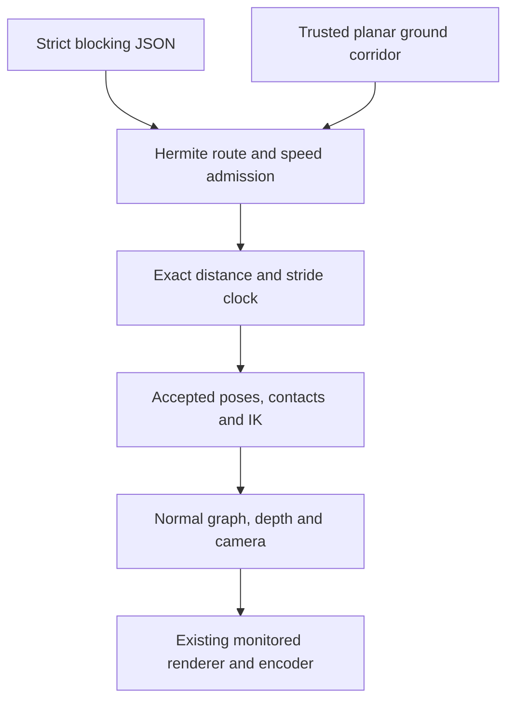

# Phase 6A — generalized planar character motion and blocking

Approved base: `15b17f795d65adf1eb9d35d28f349084681372b4`.
Branch: `phase6a-character-motion-blocking`. Local implementation/export only; no push,
deployment, Muse Spark or Phase 6B. This is an experimental motion-capability review candidate,
not production-ready general navigation.

## Result and architecture

blocking-0.1 authors one Rowan's world route, timing, facing, expression and stationary acting
as strict JSON over scene-0.1, environment-0.1 or composition-0.1. The three public examples
exercise all procedural families, and the woodland study walks past JSON-authored equipment
and stops beside it. Tests also cover a registered scene base and an actual reversed route
with a stop/turn between movement bouts.

The accepted rig, artwork, CharacterPreset poses, two-bone solver, foot roll, plant_feet,
transition_pose and secondary motion are reused. RouteClock implements the clock interface
consumed by the accepted transition controller. LocomotionClock remains the unchanged default
for legacy studies. Only optional trusted contact-step/foot-target arguments were added to
that controller. There is no second skeleton, independent gait drawing library or alternate
renderer. A frozen CharacterFrame supplies the sampled pose commands/world placement to the
normal scene evaluator; its default path preserves all previous rendering.

The scene tool accepts optional trusted frame/layer evaluators; existing callers retain the
original evaluators. Renderer, media, audio, transaction ownership and resource policies were
not changed. Legacy manifests keep their original meaning. See [BLOCKING.md](BLOCKING.md)
for exact schema, support/camera semantics and complete trajectory/contact mathematics.

Position uses cubic Hermite curves with inherited boundary velocities. Their quadratic velocity
extrema and linear acceleration extrema are checked over continuous intervals. Phase integrates
velocity times a smoothly blended inverse stride analytically as a degree-6 polynomial. Stopped
bouts calibrate to N+.56 phase so both feet finish flat; calibration outside .7..1.3 or shorter
than the supported 1.56-cycle stopping pattern is rejected. Fixed anchors and the accepted
solver cancel the actor's travel during stance. There is no mutable frame advancement.

Ground support is an explicit, narrow, trusted level_field corridor, not automatic traversal of
the drawn path. The complete monotone center route and continuous monotone foot sweep, padded
by a conservative boot-rotation bound, must fit trusted support. Decoration has no support
metadata. Only horizontal travel is supported; slopes, stairs, depth navigation, collision,
pathfinding and object interaction remain out of scope.

## Choreography and artistic review

- **Woodland traversal:** frame 0–9 idle; 9–54 walk; 54–66 decelerate/stop; 66–90 look around.
  World floor origin travels from (140,550) to (187,550). The locked background makes actual
  travel visible. Rowan passes the cart and stops beside the field radio, with the mast beyond.
- **Settlement escape:** 0–21 walk; 21–36 accelerate into run; 36–90 continue running and depart.
  World origin moves from (118,550) to (300,550). exit_right is a fixed 1.08× crop, not camera
  tracking. The character exits the frame while remaining on validated ground.
- **Shelter approach:** 0–6 observe; 6–48 approach; 48–66 stop; 66–84 turn; 84–90 hold left-facing.
  World origin travels from (165,470) to (210,470) on the entrance apron. It does not walk into
  the doorway or change depth. The stationary turn looks back toward the route.

Start/middle/end frames, heel-strike neighborhoods, speed-change frames, stops and turn frames
were inspected at full resolution and in contact sheets. Character scale and wardrobe remain
consistent. Arm swing, torso lean, planted stance and follow-through respond to the same
travel/phase clock. The route diagrams distinguish the corridor from the full ground envelope.
No moving background is used to manufacture locomotion.

The cutout remains stylized. Knees and hip height can visibly accommodate the final landing,
acting is restrained, and the three-second studies are compact demonstrations rather than a
finished story. Staging is authored: clearance from props/foreground is visually reviewed,
not collision-validated. Actor painter order remains the accepted layer order.

Turning is the principal artistic limitation. Existing side-view artwork cannot produce a
true front/back yaw. The bounded stationary two-facing dissolve is concentrated into the
central 30% of the turn to reduce ghosting, with existing acting before/after. A brief double
silhouette/transparency remains visible around the midpoint. It avoids teleporting the origin
or deforming the rig, but does not establish fully natural 3D turning. The unordered contact
pair stays fixed; near/far depth labels exchange and are quantified separately below. No
reference-quality parity or zero individual-shoe identity motion is claimed.

## Testing and credit policy

Targeted development validation passed **213 cases**: 67 new blocking cases plus 146 relevant
accepted character-polish/scene cases. The focused motion suite passed all **67** cases.
Coverage includes strict/hostile JSON fields, timing conflicts, unsupported coordinates/actions,
continuous extrema, velocity/position joins, exact phase derivatives, anchored contacts,
walk/run/stop/turn/reversal, camera compensation, support over full routes, authored-prop and
legacy scene integration, resource cancellation, protected outputs, FFmpeg failure and cleanup.

The predeclared numeric limits are 1e-7 world units for contact residual, .005 rig units for
root-pose span and .001 radians for joint-pose span across ±1 microsecond at boundaries.
They were not relaxed after observing results. An early finite-difference distance probe was
reduced from 1e-6 to 1e-7 seconds to reduce its boundary truncation error at unchanged 2e-5
velocity tolerance. An initially supposed out-of-support route was actually valid; that probe
was replaced with a narrow injected plane whose endpoints fit but boots do not. Initial logs
are retained; no accepted test or assertion was edited.

Exactly **one final complete local suite** was attempted: **860 passed, 2 failed, zero fixture
errors**, 862 total. All 795 accepted cases remain; 793 pass and these two fail:

- `test_transaction_cleanup.py::test_two_audio_jobs_persistently_clean_after_native_work`
- `test_video_integration.py::test_engineering_worker_accepts_long_render_arguments`

Both report reappearing owned temporary paths. All 67 new tests pass. No policy, cleanup
assertion or legacy test was changed to conceal the failures, and the full suite was not
rerun. Per the user's credit policy, the publication agent should perform **one standard full
CI run** on the development branch. No separate Ubuntu diagnostic branch/run is proposed by
default. Additional diagnostics should follow only a concrete unexplained CI/regression concern.

## Compatibility, decode and determinism

All **54** pinned legacy pixel checkpoints match: 18 procedural, 9 registered scene, 15 Phase 5C
composition and 12 original Rowan/orchard/story checkpoints. The original 12-second H.264/AAC
reel retains all 360 video timestamps, cuts at 120/240 and its H.264 bitstream. Audio onset
errors remain 0,−1,0 samples with zero audible drift, using the existing AAC padding policy.
No audio feature or timing semantics changed.

The three final studies and woodland repeat fully decode: **360 new decoded frames** total,
90 each, exactly 720 × 1280, 30 FPS, 3 seconds, H.264/yuv420p. Every new presentation timestamp
is exactly frame/30 using the stream's rational time base. All decoded hashes match the saved
render reports. The repeat matches all 90 source and decoded frames. Out-of-order pose,
position, geometry and pixel evaluation matches; per-frame hashes and contact diagnostics are
included. The departure intentionally leaves a static-background tail after Rowan exits;
84 unique source images in that 90-frame study are not dropped/duplicated timeline samples.

All initial proof jobs and the single shelter-turn artistic refinement passed immediate
cleanup. The final proof directories and the compatibility audio transaction also remained
clean after subsequent native decoding. These passing jobs do **not** override the two
retained full-suite restoration failures or constitute general reliability certification.

## Measured contact and performance

| Study | FPS | Render + decode | Sampled render tree | Paths / operations |
| --- | ---: | ---: | ---: | ---: |
| woodland_traversal | 17.79 | 6.08 s | 98.60 MiB | 846 / 6222 |
| settlement_escape | 33.28 | 3.65 s | 97.12 MiB | 613 / 3431 |
| shelter_approach | 22.28 | 5.15 s | 97.50 MiB | 523 / 4343 |

Maximum kinematic planted-contact residual and within-stance drift are **5.69e-14 world units**;
maximum camera-compensated output contact residual is **2.28e-13 pixels**. These are solver/FK
measurements for the active contact feature, not optical-flow measurements of every boot pixel
during heel/toe roll. The turn's unordered contact-set residual is below 2.85e-14 world units.
Its near/far label exchange is **8.46 world units / 16.92 output pixels**, as predicted by
the ±9 rig-unit footprint and .47 scale; physical individual-foot identity is not tracked in
this planar dissolve. The distinction is intentional and must not be summarized as zero turn drift.

Boundary position residuals are zero; velocity residuals are at most 3.56e-15 world units/s.
Across ±1e-6 seconds, maximum root-pose span is 5.03e-5 rig units and maximum joint span is
1.48e-5 radians, below the declared .005/.001 limits. These finite probe spans include normal
motion over the 2-microsecond interval; exact boundary continuity and probe data are both recorded.

The initial seven-job proof orchestration took **24.14 seconds**, with **126.21 MiB sampled
whole-process-tree RSS**, including parent, validation/planning, renderers and native children.
The one shelter-turn art refinement is separately recorded; no failed job was retried. Per-job
compile/render/CPU/stream measurements and errors are in the JSON reports. FPS is encode-loop
throughput rather than complete-job throughput. The strict 256 MiB budget and 64 MiB reserve
remain unchanged. RSS samples can miss transient peaks or double-count shared pages; cgroup
observations are shared-host context, not dedicated job attribution or target-VM certification.

Maximum observed complexity is **846 DrawPaths / 6222 operations**, at most 28 nodes,
20 visual instances and 7 layers. The turn temporarily uses two bounded draw passes for one
actor, reserved in the plan. All counts stay within unchanged global caps. No rendered frame
cache, new backend, new rig or resource-policy change was introduced.

See `artifacts/phase6a/` for timeline inspections, all-frame pose/position hashes, contact data,
route/support visualization, per-study transition sheets, movie decode/PTS evidence, repeat
comparison, resource/cleanup reports and retained test logs. Package checks are recorded there.

## Package verification

Ruff lint and format checks passed (125 Python files). Wheel/sdist build passed. An isolated
no-Cairo installed wheel, exercised outside the checkout, compiles and inspects all three
blocking documents and passes unchanged production CLI capabilities/schema/validation. Its
focused blocking suite reports **65 passed, 2 optional Cairo/FFmpeg cases skipped**; those
two cases ran and passed in the native 67-case suite. The smoke environment reused pinned
runtime/development distributions already available locally, installed the new wheel with
`--no-deps` and passed `uv pip check`; no fresh online resolution is claimed.

All accepted test files are unchanged. The only accepted-code integration changes are the
optional trusted contact targets in characters/transition.py, a trusted CharacterFrame in
scenes/graph.py, and optional frame/layer evaluators in tools/scene.py. Legacy defaults are
covered by the 54 exact pixel comparisons and unchanged audiovisual checks. No renderer,
encoder, audio, resource or transaction-policy implementation was modified.
